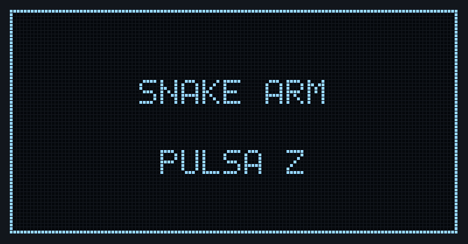
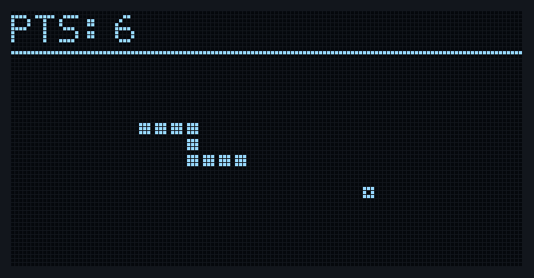
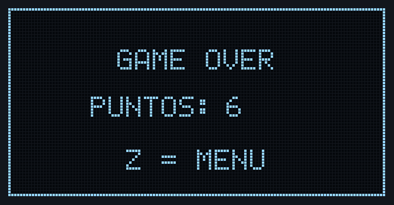
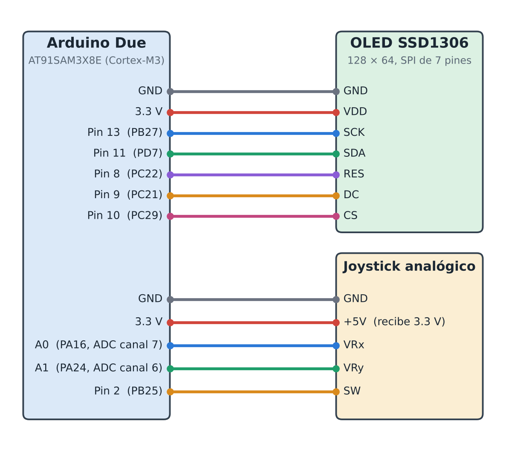
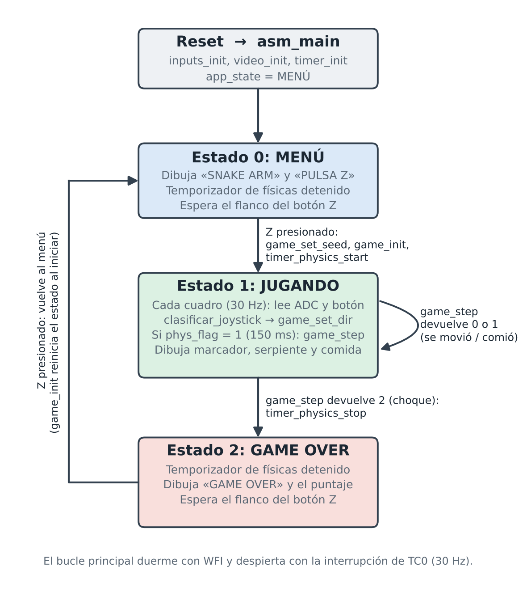

<h1 align="center">Snake ARM</h1>

<p align="center">
  Videojuego Snake escrito en ensamblador ARM, ejecutándose sin bibliotecas sobre un Arduino Due.
</p>

<p align="center">
  
  
  
  
  
</p>

<p align="center">
  
  
  
</p>

<p align="center"><sub>Menú, partida y Game Over. Imágenes generadas a partir del framebuffer que produce el código.</sub></p>

---

## Contenido

- [Descripción](#descripción)
- [Características](#características)
- [Hardware](#hardware)
- [Arquitectura del software](#arquitectura-del-software)
- [Mapa de memoria](#mapa-de-memoria)
- [Tiempos](#tiempos)
- [Compilación y carga](#compilación-y-carga)
- [Estructura del repositorio](#estructura-del-repositorio)
- [Documentación](#documentación)
- [Autor](#autor)

## Descripción

Snake ARM es una implementación del juego clásico Snake para el microcontrolador AT91SAM3X8E (ARM Cortex-M3) del Arduino Due. El jugador controla la serpiente con un joystick analógico y la imagen se muestra en una pantalla OLED SSD1306 de 128 × 64 píxeles.

La lógica del juego, el dibujo, la lectura de periféricos y el control del tiempo están escritos en ensamblador ARM (Thumb-2). Los periféricos se manejan leyendo y escribiendo sus registros mapeados en memoria, sin la API de Arduino ni bibliotecas gráficas.

Proyecto del curso **Arquitectura de Computadoras II**, Universidad Mariano Gálvez de Guatemala.

## Características

- **Menú principal** que inicia la partida con el botón Z del joystick.
- **Control analógico** en los ejes X/Y mediante el ADC de 12 bits.
- **Mecánicas completas**: avance automático, comida aleatoria, crecimiento, colisión con paredes y con el propio cuerpo.
- **Marcador en pantalla** dibujado con un mapa de caracteres propio de 5 × 7 píxeles.
- **Game Over** con puntaje final, detención del temporizador de físicas y reinicio del estado.
- **Framebuffer de 1024 bytes** en RAM, enviado completo a la pantalla 30 veces por segundo, sin parpadeo.
- **Temporizadores por hardware** con interrupciones habilitadas en el NVIC; el bucle principal no usa retardos y duerme con `WFI`.
- **Convención AAPCS** en todas las rutinas: paso de parámetros, preservación de registros y pila alineada.

## Hardware

| Componente | Detalle |
|---|---|
| Placa | Arduino Due (AT91SAM3X8E, ARM Cortex-M3 a 84 MHz) |
| Pantalla | OLED SSD1306 de 128 × 64 píxeles, interfaz SPI de 7 pines |
| Entrada | Joystick analógico de dos ejes con pulsador |
| Alimentación de los módulos | 3.3 V |

### Conexiones

<p align="center">
  
</p>

| Módulo | Pin del módulo | Pin del Due | Pin del microcontrolador | Función |
|---|---|---|---|---|
| OLED | SCK | 13 | PB27 | Reloj SPI |
| OLED | SDA | 11 | PD7 | Datos SPI (MOSI) |
| OLED | CS | 10 | PC29 | Selección de la pantalla |
| OLED | DC | 9 | PC21 | Dato o comando |
| OLED | RES | 8 | PC22 | Reset |
| Joystick | VRx | A0 | PA16 (ADC canal 7) | Eje X |
| Joystick | VRy | A1 | PA24 (ADC canal 6) | Eje Y |
| Joystick | SW | 2 | PB25 | Botón Z |

## Arquitectura del software

El código está dividido en módulos con una responsabilidad cada uno.

| Archivo | Responsabilidad | Funciones principales |
|---|---|---|
| `main_arm.S` | Programa principal, máquina de estados y dibujo de cada pantalla | `asm_main`, `app_frame` |
| `game_arm.S` | Lógica del Snake: movimiento, comida, colisiones y puntaje | `game_init`, `game_set_dir`, `game_step` |
| `video_arm.S` | Pantalla OLED por SPI, framebuffer y mapa de caracteres | `video_init`, `video_flush`, `video_pixel`, `video_text`, `video_number` |
| `inputs_arm.S` | Joystick: ADC y botón Z | `inputs_init`, `inputs_read`, `inputs_button` |
| `timer_arm.S` | Temporizadores por hardware e interrupciones | `timer_init`, `timer_physics_start`, `timer_physics_stop`, `TC0_Handler`, `TC1_Handler` |
| `control_arm.S` | Conversión de las lecturas X/Y en una dirección | `clasificar_joystick` |
| `SnakeARM.ino` | Archivo mínimo en C que entrega el control al ensamblador | llama a `asm_main` |

### Máquina de estados

<p align="center">
  
</p>

| Estado | Evento | Acción | Siguiente |
|---|---|---|---|
| Menú | Botón Z | Inicia la partida y arranca el temporizador de físicas | Jugando |
| Jugando | Paso de física sin choque | La serpiente avanza; si come, crece y suma un punto | Jugando |
| Jugando | Choque con pared o con el cuerpo | Detiene el temporizador de físicas | Game Over |
| Game Over | Botón Z | Regresa al menú | Menú |

### Ciclo de un cuadro

1. La interrupción de TC0 canal 0 activa `frame_flag` 30 veces por segundo y despierta al procesador.
2. `app_frame` lee el botón y, durante la partida, los dos ejes del joystick.
3. Si TC0 canal 1 activó `phys_flag`, `game_step` avanza la serpiente una celda.
4. Se dibuja la pantalla del estado actual en el framebuffer.
5. `video_flush` envía los 1024 bytes a la pantalla.

## Mapa de memoria

| Región | Direcciones | Uso |
|---|---|---|
| Flash | `0x00080000` – `0x000FFFFF` | Código y constantes (2381 bytes en los módulos de ensamblador) |
| SRAM | `0x20070000` – `0x20087FFF` | Variables (1912 bytes) y pila |
| Periféricos | `0x40000000` – `0x400FFFFF` | Registros de PMC, PIO, ADC y TC |
| Sistema | `0xE000E000` – `0xE000EFFF` | NVIC |

| Periférico | Dirección base | Uso |
|---|---|---|
| PMC | `0x400E0600` | Reloj de los periféricos |
| PIOA – PIOD | `0x400E0E00` – `0x400E1400` | Pines de la pantalla, del botón y entradas analógicas |
| ADC | `0x400C0000` | Ejes del joystick, 12 bits |
| TC0 canal 0 | `0x40080000` | Reloj de cuadros |
| TC0 canal 1 | `0x40080040` | Reloj de físicas |
| NVIC | `0xE000E100` | Habilitación de las interrupciones 27 y 28 |

El framebuffer ocupa 1024 bytes: para un píxel (x, y), el byte es `(y / 8) * 128 + x` y el bit es `y % 8`.

## Tiempos

El reloj de los temporizadores es MCK ÷ 128 = 84 MHz ÷ 128 = 656 250 Hz.

| Parámetro | Cálculo | Valor |
|---|---|---|
| Tasa de cuadros | RC = 656 250 ÷ 30 = 21 875 | 30 cuadros por segundo (33.33 ms) |
| Paso de física | RC = 656 250 × 0.150 ≈ 98 438 | 150 ms (6.67 pasos por segundo) |
| Envío del framebuffer | 1030 bytes por SPI a unos 5 MHz | Del orden de 2 ms (estimado) |
| Tablero | 32 × 13 celdas de 4 × 4 píxeles | 4.8 s para cruzarlo a lo ancho |

## Compilación y carga

1. Clonar o descargar el repositorio en una carpeta llamada `SnakeARM`.
2. Abrir `SnakeARM.ino` con el Arduino IDE.
3. Seleccionar la placa **Arduino Due (Programming Port)** y el puerto correspondiente.
4. Pulsar **Subir**. No se necesita ninguna biblioteca.

El Arduino IDE se usa como herramienta para ensamblar y cargar el programa. Su código de inicio configura la tabla de vectores y el reloj de 84 MHz antes de entrar a `asm_main`.

### Cómo se juega

- Presionar el botón del joystick en el menú para comenzar.
- Mover el joystick para cambiar la dirección. La serpiente no puede girar 180°.
- Cada comida suma un punto y alarga la serpiente.
- La partida termina al chocar con una pared o con el propio cuerpo.

## Estructura del repositorio

```
SnakeARM/
├── SnakeARM.ino                   Archivo mínimo en C
├── main_arm.S                     Programa principal y máquina de estados
├── game_arm.S                     Lógica del juego
├── video_arm.S                    Pantalla, framebuffer y fuente
├── inputs_arm.S                   Joystick y botón
├── timer_arm.S                    Temporizadores e interrupciones
├── control_arm.S                  Clasificación de la dirección
├── Reporte_Tecnico_SnakeARM.docx  Reporte técnico
├── README.md
└── docs/
    └── img/                       Diagramas y capturas
```

## Documentación

El [reporte técnico](Reporte_Tecnico_SnakeARM.docx) detalla el mapa de memoria, el diagrama de la máquina de estados, el esquema de conexión, el cálculo de tiempos de refresco y el uso de la pila según AAPCS.

## Autor

Desarrollado por [@Yovanygt](https://github.com/Yovanygt) para el curso Arquitectura de Computadoras II, Universidad Mariano Gálvez de Guatemala, 2026.
